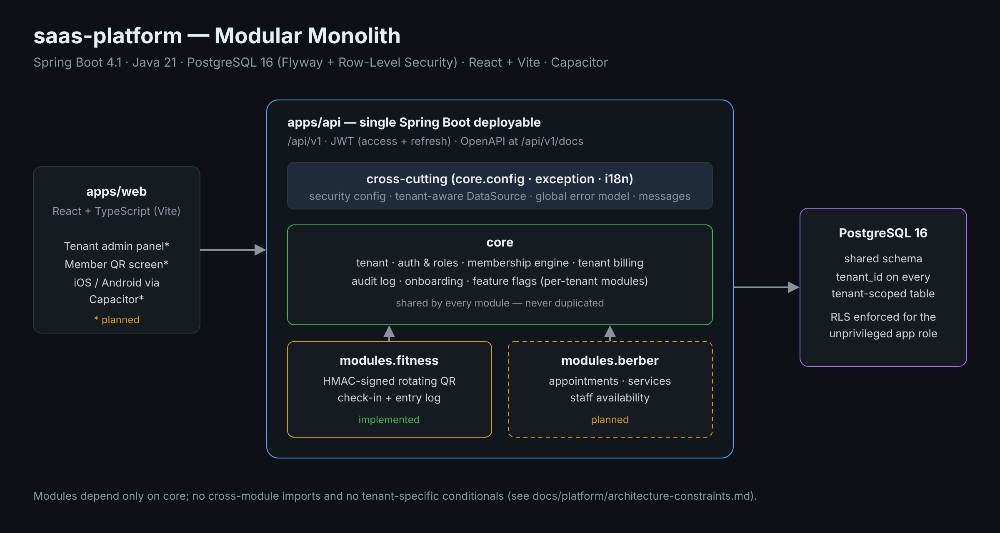

<div align="center">

# saas-platform

**A modular, multi-tenant SaaS for service businesses — starting with gyms and barbershops.**


</div>

---

## Overview

`saas-platform` is a monorepo that hosts one Spring Boot **modular monolith** and a React web app. A shared **core** (tenants, auth, memberships, billing, audit) serves every business vertical, and each vertical — **fitness**, **barber** — is a module that can be switched on per tenant. Tenant data shares one PostgreSQL schema and is isolated with `tenant_id` plus **Row-Level Security**.

The project is developed with a documented, agent-assisted workflow: every architectural decision, invariant and process rule lives in [`docs/`](docs/README.md).

## Architecture

<p align="center">
  
</p>

Key decisions (full records in [`docs/adr/`](docs/adr)):

| Decision | ADR |
|---|---|
| Monorepo layout | [0001](docs/adr/0001-monorepo-yapisi.md) |
| Spring Boot modular monolith | [0002](docs/adr/0002-spring-boot-modular-monolith.md) |
| Shared database, `tenant_id` isolation | [0003](docs/adr/0003-shared-db-tenant-id-izolasyonu.md) |
| PostgreSQL + Flyway | [0004](docs/adr/0004-postgresql-flyway.md) |
| Capacitor for mobile | [0005](docs/adr/0005-capacitor-mobil-sarmalama.md) |
| Externalised i18n strings | [0006](docs/adr/0006-i18n-string-disarida-tutma.md) |
| UTC timestamps | [0007](docs/adr/0007-utc-zaman-damgasi.md) |
| Row-Level Security | [0008](docs/adr/0008-row-level-security.md) |
| Timestamp-based Flyway versions | [0009](docs/adr/0009-flyway-timestamp-versioning.md) |

## Features

### Implemented

- **Multi-tenancy** — tenant model, per-request tenant context, tenant-aware `DataSource` and PostgreSQL RLS applied to an unprivileged application role.
- **Authentication** — JWT access tokens (20 min) and rotating refresh tokens (30 days), logout, login brute-force protection.
- **Roles** — `tenant_admin` and `tenant_staff`.
- **Membership engine** — members, membership plans and memberships with optimistic locking, shared by every module.
- **Tenant billing** — idempotent payment records linked to their source (membership, appointment, …).
- **Audit log** and **soft delete** for users.
- **Per-tenant module flags** — `@RequiresModule` guards endpoints of modules a tenant has not enabled.
- **Fitness module** — HMAC-signed QR tokens that rotate every 30 seconds, and a check-in endpoint that validates the active membership and writes an entry log.
- **Consistent error model** via a global exception handler, with Turkish message bundles.

### Planned

See [`docs/roadmap/phases.md`](docs/roadmap/phases.md): admin panel, barber appointments, Capacitor mobile apps with push notifications, and a platform-owner console.

## API

All endpoints are versioned under `/api/v1`. When the API is running, the OpenAPI UI is available at `http://localhost:8080/api/v1/docs`.

| Method | Path | Purpose |
|---|---|---|
| `POST` | `/api/v1/auth/login` | Sign in, returns access + refresh tokens |
| `POST` | `/api/v1/auth/refresh` | Exchange a refresh token |
| `POST` | `/api/v1/auth/logout` | Revoke the refresh token |
| `GET` | `/api/v1/fitness/members/{memberId}/qr-token` | Issue a short-lived QR token |
| `POST` | `/api/v1/fitness/checkins` | Validate a QR token and record an entry |
| `GET` | `/actuator/health` | Health check (includes DB connectivity) |

## Tech Stack

| Layer | Choice |
|---|---|
| Backend | Spring Boot 4.1 · Java 21 · Spring Security · Spring Data JPA |
| Mapping / boilerplate | MapStruct · Lombok |
| Database | PostgreSQL 16 · Flyway · Row-Level Security |
| API docs | springdoc-openapi |
| Frontend | React 19 · TypeScript · Vite |
| Mobile | Capacitor (planned) |
| Testing | JUnit 5 · Testcontainers · JaCoCo |
| Quality | SonarCloud · oxlint |
| CI | GitHub Actions |

## Repository Layout

```
saas-platform/
├── apps/
│   ├── api/                 Spring Boot application (Gradle)
│   │   └── src/main/java/com/saas/
│   │       ├── core/        tenant, auth, membership, billing, audit, onboarding, config, exception, i18n
│   │       └── modules/     fitness (barber planned)
│   └── web/                 React + Vite front end
├── infra/docker/            local PostgreSQL via Docker Compose
├── docs/                    architecture, ADRs, module specs, workflow, roadmap
└── .github/workflows/       CI pipeline
```

## Getting Started

**Prerequisites:** JDK 21, Node.js 20+, Docker.

```bash
git clone https://github.com/eerenyilmazz/saas-platform.git
cd saas-platform

# 1. Database (PostgreSQL on port 5433)
docker compose -f infra/docker/docker-compose.yml up -d

# 2. API — Flyway migrations run on startup
cd apps/api
SPRING_PROFILES_ACTIVE=local ./gradlew bootRun
curl http://localhost:8080/actuator/health   # {"status":"UP"}

# 3. Web (separate terminal)
cd apps/web
npm install
npm run dev                                   # http://localhost:5173
```

| Variable | Default (local profile only) | Purpose |
|---|---|---|
| `DB_PASSWORD` | `local_dev_only` | Migration (owner) role password |
| `DB_APP_PASSWORD` | `saas_app_local_dev_only` | Application role password |
| `JWT_SECRET` | local placeholder | Token signing key — **required** outside `local` |

Full setup notes: [`docs/dev-setup.md`](docs/dev-setup.md).

### Running tests

```bash
cd apps/api
./gradlew test        # unit + Testcontainers integration tests, JaCoCo report
```

## Documentation

| Start here | |
|---|---|
| [docs/kickoff.md](docs/kickoff.md) | Where to begin and which questions to ask first |
| [docs/README.md](docs/README.md) | Full documentation index |
| [docs/platform/architecture-constraints.md](docs/platform/architecture-constraints.md) | Layering and module boundaries |
| [docs/platform/domain-invariants.md](docs/platform/domain-invariants.md) | Business rules that must never break |
| [docs/platform/tenant-isolation-enforcement.md](docs/platform/tenant-isolation-enforcement.md) | How tenant isolation is enforced |
| [docs/workflow/agent-pipeline.md](docs/workflow/agent-pipeline.md) | Plan → code → review → test workflow |

> Most of the documentation is written in Turkish; code identifiers are in English.
